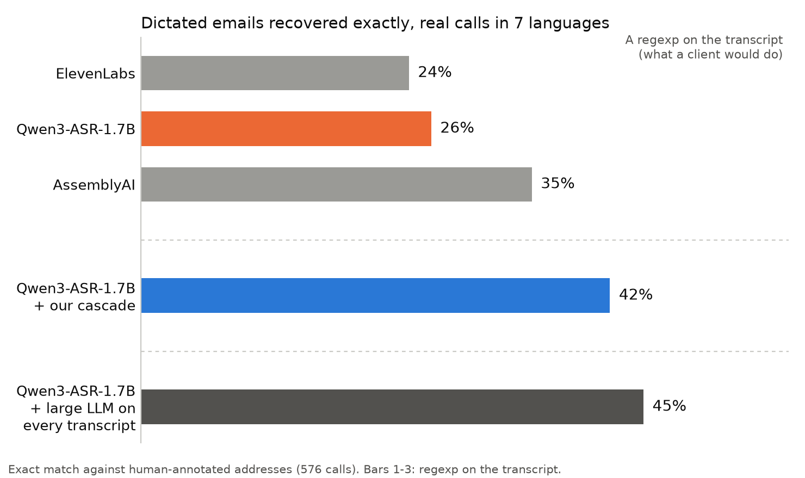

On phone calls, people dictate their email address the way they would to another person: they spell it, correct themselves, give digits and separators as words. A speech recognizer returns the words it heard, and turning them into an address is a separate problem.

| What the caller says | What the customer wants |
|---|---|
| "jeanne tiret du 8 dupont, d u p o n d, arobase gmail point com" | `jeanne_dupond@gmail.com` |
| "it's m i c h e l l e at hotmail dot com" | `michelle@hotmail.com` |
| "john dot smith at yahoo, no sorry, gmail dot com" | `john.smith@gmail.com` |
| "michel with two l, at hotmail dot com" | `michelle@hotmail.com` |
| "yes that's still the same one, sarah at the company" | not recoverable |

About half of the real calls fall in that last category: the address cannot be recovered from the transcript. On the recoverable ones, a simple regexp on the transcript, which is what a client would naturally try, recovers around half. This post is about getting to roughly the accuracy of a large LLM reading the same transcript, at a cost small enough to run in production.

## Two ways to extract the address

We worked with Qwen3-ASR-1.7B. There are two ways to turn its transcript into an address:

- **A regexp.** Cheap and instant, but it only finds addresses the ASR already wrote as `x@y.z`. Spelled letters, spoken separators, corrections and mnemonics all break it.
- **A large LLM** that reads the transcript, understands the quirks and reconstructs the address. It works much better, and it is too expensive to run on every utterance of every call.



The large LLM gets 45%. That is **what we are trying to match**, and it is close to the best that reading the transcript can do. It is not 100% because a large part of the calls are ambiguous. Often the speaker is only confirming an address the other person already has, as in the last example, or the domain name of a company is spelled in a way no model can guess. Neither the ASR nor a human annotator has the context to know the exact address.

The goal was therefore to get as close as possible to the large LLM at the lowest possible cost. The cascade below recovers 42%, which is 16 of the 19 points between the regexp and the ceiling, and runs the LLM on only 4% of the traffic, when about 2% of it actually contains an email.

## The data

- **Source.** We sifted millions of transcriptions of real calls, used with user consent for model improvement, to find calls where an email is spelled out. Each sample holds at least one dictated address, with 30 seconds to a minute of audio around it.
- **Test set.** 576 calls in six languages (French, English, Spanish, German, Portuguese, Italian), each with a human annotation of the exact address.
- **Training targets.** About 11,000 real transcripts with a dictated address, disjoint from the test set, with pseudo annotations: the address is produced by Kimi K3. For the reconstructor we keep the roughly 4,000 where Gemini 3.7 Flash produces the same address.
- **Filter test set.** 10,000 random calls, representative of the traffic, of which about 200 contain a dictated address. It is only used to measure the precision and recall of the cheap filters.
- **Metric.** Exact match after lowercasing.

## Making the LLM affordable: a cascade

Each stage is far cheaper than the next and tuned for recall, so an address is not lost on the way.

```
100%  of transcripts
  80% stop at the regexp: no email cue
  20% go to the NER tagger
        16% stop at the decision rule
         4% reach the LLM
```

**1. Regexp pre-gate.** It looks for a domain, an "at" word, an `@` or a "dot" word in several languages. On the filter test set it keeps 96% of the real addresses and sends only 20% of transcripts onward.

**2. NER tagger.** A multilingual mDeBERTa-v3 model types every fragment of the transcript with 14 labels: local part, `@`, provider, TLD, spelled letter, phonetic mnemonic ("a wie Anton"), digits, separator, self-correction, and so on.

A simple rule on the predicted tags decides whether an address is really being dictated. On the same filter test set it keeps every address and lets only 4% of transcripts through to the LLM.

**3. Crop.** Thanks to the tags, the LLM can focus on the part of the call that contains the email: it only sees the tagged region and a few words around it. A 1,000-word call becomes about 30 words, which shrinks the prompt and the prefill time of every LLM call. When two addresses are far apart, the transcript is split and each part is processed separately. About 9% of calls contain two addresses, which a classifier detects before the LLM.

**4. LLM reconstructor.** It assembles the address from the cropped text and the typed fragments.

### Training the tagger

The tagger is trained on the training targets above. Kimi K3 gets the transcript and the address, and marks which words produce each part of it; the marks become token labels. The first versions raised false alarms on website URLs, so we re-tagged the training set with a `WEBSITE` label (about 1,000 spans) to keep them out of the address. We then added a few hundred real transcripts that mention an email without giving an address, left untagged, as negatives. Together they **cut the false-positive rate from 22% to 2%**, a bigger gain than anything else we tried. The final tagger reaches a span F1 of 0.78 against the pseudo annotations.

## Choosing the reconstructor

We compared nine models without fine-tuning (a selection is shown), all given the same cropped text and the tags predicted by the NER tagger, on exact match against the human annotation. 

| Model | Exact match |
|---|---|
| Qwen3.5 0.8B | 12% |
| Qwen3.5 2B | 28% |
| Qwen3.5 4B | 35% |
| Gemma3 12B | 37% |
| Qwen3.5 9B | 40% |
| Qwen3.8 27B | 43% |
| Kimi K3 (the target) | 45% |

Accuracy climbs with size up to about 9B and then flattens. Fine-tuning small models brought little, and could even hurt, so we stayed with prompting. Our baseline prompts were optimized with DSPy's MIPROv2, which tunes the instruction and the few-shot demonstrations, on 200 balanced multilingual examples (40 per language) scored against the pseudo annotations.

### The smallest model that works is not the cheapest

The obvious pick is the smallest model that is accurate enough. That was our initial choice: a 9B model that reasons in a chain of thought. It wrote about 565 tokens per call, and sometimes ran out before reaching the answer. Output tokens dominate the cost and latency of a call, so we compared the options in accuracy and in tokens:

| Reconstructor | Exact match | Tokens per call |
|---|---|---|
| Kimi K3 (the target) | 45% | 167 |
| 9B, chain of thought | 39% | 565 |
| 27B, rules only, no reasoning | 35% | 12 |
| 27B, rules only, native reasoning | 41% | 450 |
| 27B, chain-of-thought prompt with harvested reasoning, native thinking off | 43% | 245 |
| 27B, answer-first prompt, native thinking off | 42% | 12 |

With the right prompt, a 27B model is more accurate than the 9B and writes about 45 times fewer output tokens. The next section shows how we got there.

### Teaching the model to reason without paying for it

**Step 0: rules only.** The prompt is a list of decoding rules and an instruction to output only the address:

```
Reconstruct the EXACT email address dictated in an ASR phone transcript,
using the typed NER spans. Apply these rules in order:
1. SPELLED LETTERS OVERRIDE: a spelled sequence ("d u p o n d") gives the exact
   letters and REPLACES the spoken word it clarifies.
3. DOUBLING: "with two l" doubles that letter, or confirms it is already double.
4. KEYBOARD IDIOMS: "tiret du 8" -> '_'. NEVER keep the digit.
5. NO CONVENTION DOT: join name parts with no separator unless a separator word
   is spoken. A '.' only when a dot-word is said.
...
Output the final lowercase email address.
```

Without reasoning, the model scores only 35%: it is fragile on a few dictation conventions:

- a spelled name overrides the spoken one ("dupont… d u p o n d" gives `dupond`)
- "tiret du 8" means the underscore key
- "michel with two l" implies a trailing e: `michelle`
- separators: models invent a dot between first and last name, or drop one that was spoken

**Native thinking handles them and brings accuracy to 41%, but it costs 450 tokens per call.**

**Step 1: harvest the reasoning.** We wrote 8 short dictations by hand, each exercising one of these idioms (spelled override, mnemonic letter, doubling, keyboard idiom, concatenation), ran the model on them with native thinking on, and kept only the reasoning traces that led to the correct address. Because they come from the model itself, the reasoning matches its own style. The prompt changes in two places: the instruction now asks for a short reasoning before the address, and the harvested traces are added as few-shot demonstrations of a classic chain of thought. **Native thinking is switched off:**

```
Transcript: c est dupont épelé d u p o n d arobase gmail point com
NER spans: LOCAL=dupont épelé | SPELLING=d u p o n d | AT=arobase | PROVIDER=gmail | SEP=point | TLD=com

reasoning: "dupont épelé d u p o n d": by rule 1 the spelling overrides the spoken
word, so the local part is "dupond". "arobase" -> @, "point" -> '.'.
email: dupond@gmail.com
```

Accuracy went up to 43% and the output fell from 450 to 245 tokens.

**Step 2: answer first.** The demonstrations keep the same harvested reasoning, but the order is inverted, and the instruction changes accordingly:

```
FIRST output the final lowercase email address, THEN on the next line write
'reason:' followed by a brief reason.
```

```
dupond@gmail.com
reason: "dupont épelé d u p o n d": by rule 1 the spelling overrides the spoken
word, so the local part is "dupond". "arobase" -> @, "point" -> '.'.
```

At inference the model writes the address first and generation is stopped right after it, so the reason is never generated. It only lives in the prompt, where it teaches the rule by example. That removes the thinking tokens: only the 12 tokens of the address remain, for a one-point loss in accuracy, and the hard idioms stay stable.

**LLM-based reconstruction limitation.** LLMs read tokens, not letters, which is why they famously cannot count the "r" in strawberry. The same blind spot limits how well they fix a spelling, for instance deciding that "Remi" is written with a Y. With real reasoning a model can work around it by first writing the word letter by letter, and native thinking does this to some extent. Our answer-first prompt gives up that step, and we observed it is significantly worse on these cases. We deemed the balance to be in favour of the no-thinking version: such samples are rare in our real data, and even with thinking on the model is far from perfect.

## Results

End to end, with the NER predicting its own tags, exact match against the human annotation on the 576 calls:

| Language | Regexp | Our cascade | Kimi K3 (target) |
|---|---|---|---|
| French | 10% | 38% | 41% |
| German | 17% | 38% | 41% |
| Spanish | 26% | 37% | 40% |
| Portuguese | 31% | 39% | 42% |
| Italian | 32% | 47% | 50% |
| English | 51% | 60% | 63% |
| **All** | **26%** | **42%** | **45%** |

The cascade is 16 points above the regexp and 3 below the target. The gain is largest where spelling conventions are hardest and a regexp does worst: French goes from 10% to 38%.

## Inline replacement

Because the tagger gives the position of every fragment, the reconstructed address replaces only the dictated words in the transcript, and the rest of the call is untouched. On calls without any email (averaging 10 minutes), the change in word error rate is 0.003%, and only 0.1% of them get a wrong replacement. On calls with an email, the spelled fragments, about 4 words at the median, collapse into one address token.
