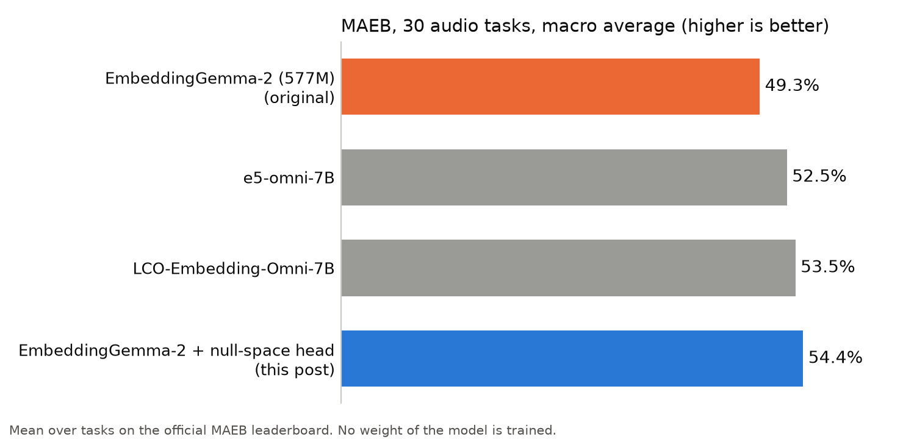

Audio encoders aligned to text keep what was said and progressively throw away how it was said: the voice, the pitch, the emotion. That information is still there in their intermediate layers. To show it, I took [EmbeddingGemma-2](https://huggingface.co/google/embeddinggemma-2) (577M parameters), which embeds text, images, video and audio in the same 768-dimensional space, and wrote features from two intermediate layers of its audio encoder into 256 dimensions that text never uses, without training a single weight.

On [MAEB](https://mteb-leaderboard.hf.space/benchmark/MAEB(v1)), the 30-task audio benchmark of the MTEB leaderboard, the score goes from 49.3% to 54.4%. That moves the model from rank 16 to rank 1 on the full benchmark (from 26 to 1 on the audio-only one), ahead of 7B to 9B multimodal models.

The rank partly reflects the benchmark. MAEB averages many acoustic tasks on which semantic embedders score close to zero, so any acoustic signal brings large gains.

## Semantics-aligned audio encoders progressively throw away paralinguistic information

An audio encoder aligned to a text LLM is trained to keep what was said. On MAEB, the LLM-backed embedders score 95 to 99% on multilingual text-to-audio retrieval, but only 1 to 6% on unsupervised audio clustering and around 20% on vocal emotion recognition. Voice, pitch, emotion and sound texture do not survive in the final layers.

[Bouziane, Mdhaffar and Estève](https://arxiv.org/abs/2603.08312) make the same point about speech encoders aligned only with semantic embeddings, whose paralinguistic information may be suppressed. Their work is what motivated this experiment.

The information survives in the earlier layers. Other encoders show it: different attributes (speaker, emotion, content) live at different depths ([Pasad et al.](https://arxiv.org/abs/2107.04734), [Bouziane et al.](https://arxiv.org/abs/2610.21941)). I probed the 12 Conformer layers of EmbeddingGemma-2 one by one, and found the same:

- **Layer 2** carries the speaker. Gender clustering on VoxPopuli goes from 0.05% at the final output to about 65%.
- **Layer 6** carries the emotion. Emotion classification on CREMA-D doubles, from 19.7% to 39.5%.

## 256 free dimensions

The text backbone of EmbeddingGemma-2 works in 512 dimensions, and a final linear layer expands its output to 768. This is a strange characteristic of the model: a 512-dimensional signal is stretched into a 768-dimensional vector, so every text embedding only occupies a 512-dimensional slice of the space. The other 256 directions, which a simple matrix decomposition (an SVD) gives exactly, are never used by text.

That is what allows adding information for free in the final embedding. Anything written along those 256 directions has a zero dot product with every text embedding, so it cannot change how a text matches an audio clip or another text. Text embeddings receive nothing at all.

## Zero training

1. Pool layer 2 (mean and standard deviation over time) and layer 6 (mean) of the audio encoder.
2. Reduce each to 128 dimensions with a PCA, softly whitened, and concatenate them into 256 dimensions.
3. Write this vector along the 256 free directions, add it to the usual embedding of the clip, then normalize.

The PCA is fitted on 1,400 clips, 350 from each of four external datasets with clips capped at 10 seconds: [Expresso](https://huggingface.co/datasets/ylacombe/expresso) (expressive speech), [AudioSet](https://huggingface.co/datasets/agkphysics/AudioSet) (audio events), [music_genres](https://huggingface.co/datasets/lewtun/music_genres) (music) and [ESC-50](https://huggingface.co/datasets/ashraq/esc50) (environmental sounds). No MAEB audio is used. Text embeddings are bit-for-bit unchanged, and text-to-audio retrieval in 100+ languages stays within 0.3 points of the base model.

## Results

Audio-to-audio tasks, which are the ones the base model fails, gain the most:

| Task | Base | With the head |
|---|---|---|
| Gender clustering (VoxPopuli) | 0.05% | 63.1% |
| Gender classification (IEMOCAP) | 66.4% | 85.8% |
| Emotion classification (CREMA-D) | 19.7% | 40.2% |
| Artist retrieval (Jamendo) | 55.2% | 93.8% |
| Environmental sounds (FSD2019) | 38.8% | 56.3% |
| Music genre (GTZAN) | 57.7% | 71.5% |

## Conclusion

This small experiment, with no training at all, belongs to a line of research that is already active: keeping several kinds of information in one speech encoder, as in Bouziane et al. ([semantic and speaker](https://arxiv.org/abs/2603.08312), [multi-attribute distillation](https://arxiv.org/abs/2610.21941)). Here the idea is applied to a recent and very strong embedding model. It shows how much information a semantics-aligned audio encoder throws away in its final layers, and how easily the intermediate layers give it back.

## Limits

- **The numbers are optimistic.** I chose the layers, the whitening and the strength of the injection by looking at the test scores, over a small grid. The PCA itself never saw MAEB, but the choice of configuration did.
- **Some tasks get worse.** Spoken topic classification (SIBFLEURS) falls from 57.2% to 21.3%, spoken intent (MInDS14) from 97.6% to 88.3%, and spoken question answering (NMSQA) from 98.1% to 78.7%. The head adds noise for these tasks, which was expected given how crude the method is.
- **No Matryoshka truncation for audio.** EmbeddingGemma-2 is trained so that its embedding can be cut to its first 512, 256 or 128 dimensions, for cheaper storage and search. The added acoustic part is spread over all 768 coordinates and only stays separate from the text directions when it is complete. Truncated audio embeddings would lose part of it, so audio needs all 768 dimensions.

The model is on Hugging Face as [BrunoHays/embeddinggemma-2-nullspace-audio](https://huggingface.co/BrunoHays/embeddinggemma-2-nullspace-audio), with the per-task results for all 30 tasks. The official ranking is on the [MAEB leaderboard](https://mteb-leaderboard.hf.space/benchmark/MAEB(v1)).
