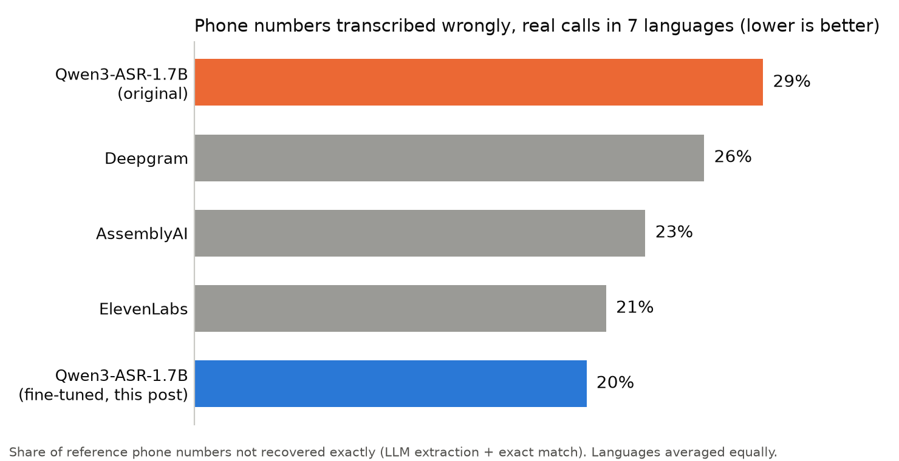

On real phone calls in seven languages, Qwen3-ASR-1.7B gets 29% of the phone numbers wrong, against 23% for AssemblyAI and 21% for ElevenLabs.

This post is about closing that gap. The main challenge was improving digit recognition **without degrading everyday speech transcription**. Two attempts with reinforcement learning were unsuccessful. What worked is a masked supervised fine-tuning (SFT) on corrected transcripts, followed by a re-distillation of the original model. I end with a model that is on par with ElevenLabs on phone numbers and on par with the original model on everyday word error rate (WER).

## Data and metric

**Test set.** We sifted millions of transcriptions of real calls, used with user consent for model improvement, to curate calls that contain at least one phone number, each with 30 seconds to a minute of audio around it. The calls were transcribed by humans. The set holds about 425 clips in seven languages.

**Metric.** WER is the wrong tool here: one wrong digit makes a number useless. Moreover, real calls are messy: people get interrupted while spelling, repeat parts and correct themselves. So an LLM (Gemini 2.5 Flash) extracts the phone numbers from the transcript. The score is binary: a number is either exactly the reference or wrong.

**Forgetting.** To measure forgetting, we track WER on dozens of public and internal datasets, in the same seven languages.

**Training data.** It comes from the same real calls, and every call of the test set is excluded. A named entity recognition (NER) model found the phone numbers, and the audio was cut into short clips around them. The pseudo annotations differ across the experiments below.

## First attempts with RL

I started with reinforcement learning for two reasons. First, GRPO (Group Relative Policy Optimization) has been shown to improve WER ([Shivakumar et al.](https://arxiv.org/abs/2509.01939)), and to make the decoder rely more on the audio: [Kumar et al.](https://arxiv.org/abs/2607.08409) find that it keeps attention anchored to the audio and cuts insertions, which suits digits that are spelled out. Second, RL is known to forget less than SFT, because it only trains on the model's own samples and mostly reshapes behaviour the model already has, whereas SFT pulls the model towards the training data (see [this post](https://nrehiew.github.io/blog/sft_rl_opd/) for a good discussion). Forgetting being the main constraint, this looked like the right tool.

### Attempt 1: RL against ElevenLabs transcripts

The first idea was to use ElevenLabs as the teacher: GRPO with the whole-clip WER against its transcripts as the reward, on about 11,000 clips of 7 to 11 seconds.

It worked on the reward: the WER against ElevenLabs on a dev set fell from 44% to 31%. It did not work on the goal. **The model learned ElevenLabs' style while its digits stayed the same**: phone errors went from 29.1% to 29.0%. A whole-clip reward is dominated by the hundreds of tokens that are not digits, so that is what the policy optimizes. On the plus side, nothing was forgotten (English WER on the generalist set went from 7.6% to 7.7%).

### Attempt 2: RL with a reward that targets digits

So I made the reward about the digits: the whole-clip term plus a term on the character error rate of the phone-number spans, found with an NER model, and with advantages normalized per term so the dense WER term could not drown the sparse digit one. The reference was now the ElevenLabs transcript corrected by Gemini.

Before launching, I measured what this reward could do:

- Against an LLM judge, it ranked pairs of hypotheses correctly about two thirds of the time. Noisy, but usable.
- Offline, the base model gets an exact number in 12% of its samples at k=1 and in 35% of the prompts when taking the best of 32. A small headroom, but a seemingly usable one.

The run stayed flat, with phone errors at 31.2% before and after. The best-of-32 figure explains why: it means that for about two thirds of the prompts, none of the 32 samples is correct, and those prompts give no gradient. An overfit test on 8 prompts confirmed it: even with 32 samples per prompt, **6 of 8 prompts never produced a single correct number**. The headroom was concentrated on a third of the prompts, too thin to learn from at this small scale.

The sharper way to see it: plain SFT on the same kind of data reached 40% exact numbers in greedy decoding, above the best of 32 samples from the base model (35%). This means we need to go beyond sharpening the model and expand its capabilities, and that is where SFT comes in.

## Masked splice-SFT

The RL rollouts were not informative enough: the model rarely produced a correct number, so there was not enough to reinforce. The distribution of the model itself had to change, and that takes SFT. The challenge is that naive SFT rewrites the whole sentence, which is where forgetting comes from. The recipe that worked:

1. **Hard pool.** Out of about 90,000 clips cut from our training set, we kept the 55,000 where Qwen3-ASR and ElevenLabs disagree on the number.
2. **Target.** Qwen3-ASR's own transcript, in which Gemini 3.8 Flash, listening to the audio, fixed only the phone-number spans. This teacher reaches 19.8% phone errors on the test set, on par with ElevenLabs, which is why it makes a good target.
3. **Masked loss.** Only the tokens of the fixed spans are trained on.

The targets are near on-policy, so there is almost nothing to learn outside the spans.

I then tried three variants, all evaluated on phone errors and everyday WER:

- **Decoder LoRA only.** Phone errors fall from 28.0% to 23.4%, and everyday WER stays flat. It plateaued there whatever I changed: the encoder is what hears the digits.
- **Decoder + audio-encoder LoRA.** Phone errors fall to 21.1%, but everyday WER rises to 19.4%, with repetition loops on some languages.
- **Decoder + encoder, then re-distillation.** The encoder LoRA brings the phone-number gains but damages everyday transcription. To repair it, a second short stage (300 steps) starts from that model and freezes the audio LoRA, so the gains are kept. It trains only the decoder LoRA to imitate the original model on 8,000 real clips (100 hours) that contain no numbers: a KL divergence loss pulls its output, token by token, towards the output of the original model run on the same clip. Phone errors stay at 20.9% and everyday WER is back to 16.2%. Doing the same thing during the number training instead froze the gains at 25.1%.

## Results

| Phone-number test set | Phone errors | Everyday WER (internal datasets) |
|---|---|---|
| Qwen3-ASR-1.7B (original) | 28.0% | 16.6% |
| ElevenLabs | 20.7% | |
| Gemini 3.8 Flash, fixing the transcript with the audio | 19.8% | |
| SFT, decoder only | 23.4% | 16.8% |
| SFT, decoder + audio encoder | 21.1% | 19.4% |
| **SFT, decoder + audio encoder + re-distillation** | **20.9%** | **16.2%** |

The final model is on par with ElevenLabs on phone numbers and with the original model on everyday WER. In the end RL was not even needed: the recipe that works contains none.

On our full test suite, which comprises more than 40 public and internal datasets in the seven languages, the final model is flat overall. WER per language, original model vs final model:

| Language | Public, original | Public, final | Internal, original | Internal, final |
|---|---|---|---|---|
| English | 5.9% | 6.0% | 7.6% | 7.8% |
| French | 11.2% | 11.2% | 16.4% | 16.2% |
| Italian | 7.9% | 8.1% | 18.3% | 18.4% |
| Spanish | 4.6% | 4.8% | 12.7% | 12.9% |
| German | 7.7% | 8.0% | 16.0% | 16.1% |
| Portuguese | 8.3% | 8.7% | 16.8% | 16.9% |
| Dutch | 9.1% | 9.6% | 28.1% | 25.3% |
| **Average, 7 languages** | **7.8%** | **8.1%** | **16.6%** | **16.2%** |
| Russian (not in training) | 5.2% | 5.2% | | |

The degradation is very small, at most 0.5 points per language on the public datasets. Russian was not part of the training and does not move at all, which shows the model did not forget outside the languages it was trained on.
